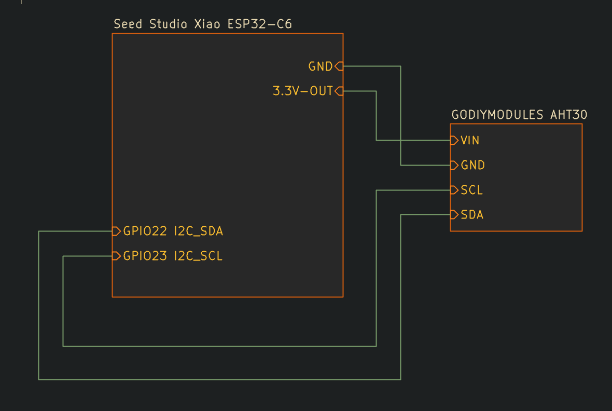

# AHT30

This is a simple Arduino Studio sketch that uses the AHT30 temperature and humidity sensor.

I built this using a [Seeed Studio Xiao ESP32-C6](https://wiki.seeedstudio.com/xiao_esp32c6_getting_started/) and an [AHT30 temperature andn humidity sensor](https://www.amazon.com/dp/B0F1JWWFT7?ref=ppx_yo2ov_dt_b_fed_asin_title).

The modules are wired up as follows:

